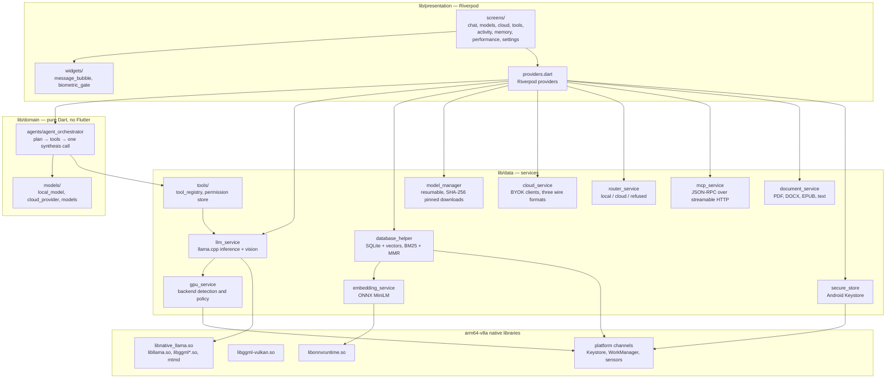

<div align="center">


# LocalMind

**A fully local, privacy-first AI agent for Android.** The language model runs on
your phone through llama.cpp — no account, no server, no telemetry. Everything
stays on the device unless you deliberately add a cloud key.

[](https://github.com/skullrex0987-ctrl/Opendotsapk/actions/workflows/build-apk.yml)
[](https://github.com/skullrex0987-ctrl/Opendotsapk/releases/latest)
[](#license)
[](https://developer.android.com/guide/topics/manifest/uses-sdk-element)
[](https://github.com/ggerganov/llama.cpp)

[**⬇ Download the latest APK**](https://github.com/skullrex0987-ctrl/Opendotsapk/releases/latest) &nbsp;·&nbsp;
[Model support](docs/MODEL_SUPPORT.md) &nbsp;·&nbsp;
[FAQ](docs/FAQ.md) &nbsp;·&nbsp;
[Release notes](docs/RELEASE_v1.6.0.md)

</div>

<div align="center">

| Offline-first | Your keys in the Keystore | Vulkan GPU offload | AES-GCM at rest |
|:---:|:---:|:---:|:---:|
| Inference, retrieval and documents never leave the device | Never in `shared_preferences`, never in a row | Auto / GPU / CPU with CPU fallback | Chats, memories, notes and chunks |

</div>

<div align="center">

v1.6.0 is the build in preparation. The newest published APK is
[v1.5.1](https://github.com/skullrex0987-ctrl/Opendotsapk/releases/tag/v1.5.1);
the Download link above always resolves to whatever is actually released.

</div>

---

## What's new in v1.6.0

v1.6.0 is the **Qwen3.5 fix release plus a UI pass**. Four of the changes below
are bugs a real phone found; the rest is the design work that turns eleven
independently-styled screens into one app.

| | Change | Why it matters |
|---|---|---|
| 🐛 | **Qwen3.5 0.8B can finally load as the chat model** | Selecting it was rejected because it is registered as `ModelKind.vision`, so the app silently fell back to a model you never downloaded. **Load** failed forever, however many times you tried. |
| 🐛 | **The architecture warning named the wrong model** | It blamed Qwen2.5 0.5B while Qwen3.5 was selected on screen. The picker read its selection through the catalog's label, not the section you tapped. |
| 🐛 | **Staggered list entrances no longer crash** | Every staggered list — Activity, Memory, Cloud — would have thrown a Flutter assertion on first paint. Caught by the test suite, not by a device. |
| 🐛 | **Undownloaded models no longer look installed** | `FileStat.stat` returns `notFound` rather than throwing, so the size probe read `-1` bytes as a present file. |
| ✨ | **One theme, one motion language** | `lib/core/theme` now owns every colour, radius, curve and duration. Eleven screens stop inventing their own. |
| ✨ | **Designed empty and error states** | "Nothing here yet" is a built component with a glyph, one sentence and at most one action — instead of a bare string on four different screens. |
| ⚡ | **Model list stops re-reading the disk** | One `stat` instead of two, memoised documents directory, and a TTL cache invalidated by the exact path each write touches. |
| 🔇 | **Six silent `catch` blocks now log** | A failed download cleanup, an unreadable provider config, a tool permission that did not persist — all were invisible and all looked like the app ignoring you. |

Full detail, including the evidence for each bug: [docs/RELEASE_v1.6.0.md](docs/RELEASE_v1.6.0.md).

---

## Why this app

- **Works with the network off.** Inference, embeddings, retrieval, documents and
  tool permissions are all on-device. Pull the aeroplane-mode switch and the app
  still chats.
- **No account, ever.** There is no LocalMind backend, no sign-up, and no shared
  quota. Nothing to log into means nothing to leak.
- **No telemetry.** The app makes no analytics call. The only network code paths
  are the ones you turn on: a cloud provider you configure, or `web_search`.
- **Your keys stay in the Android Keystore.** API keys and the database key are
  written to the hardware keystore and read at the moment a request is made —
  never into `shared_preferences`, never into a database row.
- **A real LLM, on your GPU.** Quantized GGUF models through llama.cpp with
  Vulkan offload, an Auto/GPU/CPU policy, a throughput benchmark, and a CPU
  fallback when the GPU driver refuses the model.

## Feature matrix

State is what the code and `docs/` actually say, not what a roadmap hopes for.

| Feature | State | Note |
|---|---|---|
| Local LLM inference | Working, device-pending | llama.cpp via `native_llama`. CI asserts `libllama.so` and the mtmd/CLIP vision symbols are in every APK. |
| Vision (image understanding) | Working, device-pending | Qwen3.5 0.8B: one GGUF carries the language model and its ViT, `mmproj-F16` supplies the merger. |
| GPU offload (Vulkan) | Working, device-pending | `libggml-vulkan.so` ships and exports `ggml_backend_vk_reg`. A refused GPU init retries once on CPU. |
| CPU backend | Working | Thread count adjustable (1–4) on the Performance screen. |
| Embeddings (ONNX) | Working | all-MiniLM-L6-v2, 384-dim, mean-pooled and L2-normalised. |
| Hybrid retrieval + reranking | Working | BM25 keyword score fused with cosine similarity, then MMR reranking. |
| Document ingestion | Working | PDF (FlateDecode), DOCX, EPUB, and the plain-text family. |
| Model catalogue + downloader | Working | Nothing is bundled. Downloads resume after an interruption and are promoted only on a size + SHA-256 match against a pinned manifest. |
| Android tools + permissions | Partial | 10 tools defined, 3 implemented (`web_search`, `get_location`, `analyze_image`). The other 7 declare themselves unimplemented and are hidden from the model rather than faked. |
| Multi-agent pipeline | Partial | Rewritten to plan → tools → one synthesis call. Exposed as a Riverpod provider; not yet wired into the chat screen. |
| Voice in / out | Working | `speech_to_text` (single utterance) and `flutter_tts`, with a Settings toggle. |
| Cloud models (BYOK) | Working | 8 catalogue entries — OpenAI, Anthropic, Gemini, Groq, DeepSeek, OpenRouter, Ollama/LM Studio, and **Custom** for any other OpenAI-compatible endpoint. Key in the Keystore, read only when a request is about to be made. |
| Local/cloud router | Working | On-device / Auto / Cloud, plus a private mode that forbids network use absolutely. |
| MCP client | Working, session-scoped | JSON-RPC over streamable HTTP; server tools join the agent's tool set. The server list is held in memory and is not restored on restart. |
| At-rest encryption | Working | AES-GCM over message, memory, note, chunk and activity fields. If the Keystore is unavailable the app says so and continues in plaintext rather than losing your data. |
| Biometric lock | Working, device-pending | `local_auth` gate plus `FLAG_SECURE` so chat is absent from screenshots and the recents thumbnail. |
| Background tasks | Scaffolded | WorkManager is initialised with a dispatcher. No recurring task is registered yet. |
| NPU acceleration | Not used, not claimed | The NPU is detected and named on the Performance screen; there is no portable llama.cpp NPU backend to call. |
| Release signing | Debug key | Until the four `ANDROID_KEY*` secrets exist, CI renames the artifact `*-DEBUGSIGNED-NOT-UPDATABLE.apk` and proves it with `apksigner`. See [docs/RELEASE_SIGNING.md](docs/RELEASE_SIGNING.md). |
| 16 KB page alignment | Gated, not fixed | CI checks every shipped `.so`. `libonnxruntime.so` from `onnxruntime` 1.4.1 is still `0x1000`. See [docs/PAGE_ALIGNMENT.md](docs/PAGE_ALIGNMENT.md). |
| Verified on a physical device | Partial | Bug reports from a real phone found the vision failure and the download loop. No build has passed the full [device checklist](docs/DEVICE_TEST_CHECKLIST.md) yet. |

## Model catalogue

Pick one in **Settings → Models**; the app downloads it with live progress. Sizes
are the exact pinned byte counts; the in-app picker rounds them to binary units.

| Model | Role | Size | RAM | Notes |
|---|---|---|---|---|
| Qwen2.5 0.5B Instruct Q4_K_M | chat | 397,000,000 B · 379 MB | ~600 MB | Catalogue default. Best tool-calling at this size. |
| SmolLM2 360M Instruct Q8_0 | chat | 386,000,000 B · 368 MB | ~550 MB | Fastest option; smallest RAM footprint. |
| Qwen2.5 1.5B Instruct Q4_K_M | chat | 1,120,000,000 B · 1.04 GB | ~1.4 GB | Best quality; needs more RAM and a faster phone. |
| **Qwen3.5 0.8B Q4_K_M + mmproj-F16** | **chat + vision** | 737,504,352 B · 703 MB | ~1.1 GB | One download both chats and sees. |
| Moondream2 q5_k + mmproj | vision | 1,969,388,000 B · 1.83 GB | ~2.4 GB | Listed but **disabled** — see below. |
| all-MiniLM-L6-v2 | embeddings | ~91,000,000 B · 87 MB | ~120 MB | ONNX encoder + `vocab.txt`; without it Memory search does nothing. |

**Moondream2 is listed but can never load.** The vendored llama.cpp identifies a
vision projector by a member of the `projector_type` enum in
`tools/mtmd/clip-impl.h`, and that enum has 42 members — none of them Moondream.
`grep -rn MOONDREAM tools/mtmd/` returns zero hits, so the projector parses as
`PROJECTOR_TYPE_UNKNOWN` and `initVision` fails on every phone. It stays in the
catalogue with an `unsupportedReason` and a greyed-out row so that anyone who
already downloaded 1.97 GB gets an explanation instead of a mystery. Files on
disk are never deleted. Full evidence: [docs/MODEL_SUPPORT.md](docs/MODEL_SUPPORT.md).

**Qwen3.5 is dual-role.** It is registered as a vision model because vision is
why it is listed, but it is equally a chat model — one GGUF carries both. It
therefore appears in the chat list and the vision list, and selecting it on both
sides is the correct pairing rather than a conflict.

**Needle (Cactus) is not supported.** It ships as `.cact` + `.safetensors` with
its own native runtime, not GGUF, so it cannot be loaded through llama.cpp.

## Screenshots

No images ship in this repository yet. To add them: put the files in
`docs/screenshots/` as `chat.png`, `models.png`, `memory.png`, `performance.png`
and `settings.png`, then replace this paragraph with one markdown image per
file — ``, ``
and so on. A missing image looks worse on a repository page than an honest note.

## Quick start

1. Download the APK from [Releases](https://github.com/skullrex0987-ctrl/Opendotsapk/releases/latest)
   and install it (arm64 device, Android 9 or newer).
2. Open the app and read the three onboarding screens — they say where your data
   goes.
3. Open **Settings → Models**, pick a chat model, and let it download. Nothing
   is bundled in the APK.
4. Tap **Load**. The header shows the model that is actually in memory, which is
   not always the one selected — the sheet tells you when those differ.
5. Chat. Type, hold the mic, attach a photo, or attach a PDF/DOCX/EPUB.

Optional, in **Settings**:

- **Cloud models** — add a provider and paste your own key. "Test connection"
  confirms it. Routing defaults to Auto.
- **Private mode** — forbids all network use regardless of other configuration.
- **Performance** — read the detected SoC/RAM/GPU, pick Auto/GPU/CPU, and run the
  throughput benchmark on your own hardware.

### Build it yourself

Requires Flutter 3.x (CI pins **3.47.7**), JDK 17, Android SDK 36 with NDK
28.2.13676358, and the Vulkan shader compiler `glslc`. Without `glslc` the
Vulkan backend never links and the build fails with
`undefined symbol: ggml_backend_vk_reg`; `scripts/patch_native_llama.py` detects
it and degrades to a CPU-only link instead.

```bash
sudo apt-get install -y glslc spirv-tools libvulkan-dev   # glslc is not optional for GPU
flutter pub get
python3 scripts/patch_native_llama.py                    # --cpu / --require-gpu are accepted
flutter build apk --release --target-platform android-arm64
```

Pushing a `v*` tag does all of this in GitHub Actions, then gates the result:
unit and widget tests, 16 KB page alignment, APK version against the tag, native
library presence, `apksigner` verification, and a `SHA256SUMS` file.
See [.github/workflows/build-apk.yml](.github/workflows/build-apk.yml) and
[BUILD_OPTIONS.md](BUILD_OPTIONS.md) for the alternatives if you would rather not
install the Android toolchain locally.

Models can also be fetched without the app:

```bash
./download_model.sh list
./download_model.sh qwen05b     # smollm2 | qwen15b | moondream2 | all
```

## Architecture



In one paragraph: `lib/presentation` holds the Riverpod-wired screens and widgets
and never touches a native library directly. `lib/domain` holds the pure-Dart
logic — the model catalogues and the plan/execute/summarise agent — so it can be
unit-tested without Flutter or a device. `lib/data` is where everything impure
lives: llama.cpp inference, ONNX embeddings, SQLite with a vector table and BM25
statistics, the model downloader, the MCP client and the Keystore wrapper. Those
services are the only code that crosses the plugin boundary, which is why
`lib/core/theme` can hold one theme and one motion language for the whole app.

## Project layout

```
lib/
├── main.dart                    Entry: keystore, connectivity, WorkManager
├── app.dart                     Root widget, theme, splash, biometric gate
├── core/
│   ├── constants/               app_constants.dart — prompts, permissions, defaults
│   ├── security/                crypto_box.dart — AES-GCM at-rest field encryption
│   ├── theme/                   app_theme.dart, motion.dart
│   └── utils/                   log.dart, text_utils.dart, turn_builder.dart, json_extract.dart
├── data/
│   ├── database/                database_helper.dart — SQLite + vectors, hybrid search
│   ├── services/                llm, gpu, embedding, model_manager, cloud, router,
│   │                            mcp, document, pdf_text_extractor, secure_store
│   └── tools/                   tool_registry.dart, tool_permission_store.dart
├── domain/
│   ├── agents/                  agent_orchestrator.dart
│   └── models/                  local_model.dart, cloud_provider.dart, models.dart, tool_result.dart
└── presentation/
    ├── screens/                 main, chat, models, cloud, tools, activity,
    │                            memory, performance, settings, onboarding
    ├── providers/               providers.dart
    └── widgets/                 message_bubble.dart, biometric_gate.dart
android/app/                     arm64-v8a only, minSdk 28, targetSdk 35
scripts/                         patch_native_llama.py, check_page_alignment.py
docs/                            decisions, checklists and audit evidence
test/                            14 unit and widget test files
```

## Development

```bash
flutter test        # 244 unit and widget tests; CI treats a failure as a build failure
```

The tests cover text chunking and BM25 scoring, AES-GCM and the float32 vector
codec, the local/cloud routing rules, hybrid retrieval and MMR, document
parsing, the model catalogue and download planning, the tool registry's honesty
contract, and chat-model selection.

**Versioning rule.** `version:` in `pubspec.yaml` must equal the release tag
(`v1.6.0` → `1.6.0`). The workflow derives the version name from the pushed tag,
builds the APK, then fails the job if the APK's `versionName` disagrees with it.
A drift is caught before anything ships rather than after.

**Further reading.**

| Document | What it settles |
|---|---|
| [docs/MODEL_SUPPORT.md](docs/MODEL_SUPPORT.md) | Why each catalogue entry works or cannot work, with the grep evidence. |
| [docs/GPU_ACCELERATION.md](docs/GPU_ACCELERATION.md) | What ships, the `glslc` trap, and when the GPU is slower than the CPU. |
| [docs/PAGE_ALIGNMENT.md](docs/PAGE_ALIGNMENT.md) | 16 KB pages: what the CI gate checks and which library still fails. |
| [docs/RELEASE_SIGNING.md](docs/RELEASE_SIGNING.md) | How to create the release keystore and add the four secrets. |
| [docs/DEVICE_TEST_CHECKLIST.md](docs/DEVICE_TEST_CHECKLIST.md) | The pass a human must run before a build is called working. |
| [docs/AUDIT_PROGRESS.md](docs/AUDIT_PROGRESS.md) | Task board, CI run ids, and what each green run does and does not prove. |
| [docs/ADR-native-binding.md](docs/ADR-native-binding.md) | Patched pub package vs an owned pinned wrapper. |
| [docs/SPIKE-litert-lm.md](docs/SPIKE-litert-lm.md) | Whether a LiteRT-LM backend is worth it for MediaTek NPUs. |
| [docs/FAQ.md](docs/FAQ.md) | Short answers to the questions people actually ask. |

## Status and roadmap

Green CI is not the same as a working app. The infinite "Thinking…" bug of v1.1.0
compiled cleanly and passed every test, and only showed up on hardware. What is
next, in order:

1. **Wire the agent into chat.** `AgentOrchestrator` is complete and tested but
   has no call site in the UI.
2. **Replace the `onnxruntime` plugin.** 1.4.1 is the newest version on pub and
   ships a 4 KB-aligned `libonnxruntime.so`, which is why the alignment gate
   still warns.
3. **Add the release keystore.** Four GitHub secrets turn debug-signed artifacts
   into updatable ones.
4. **Run the device checklist.** Nothing can honestly be called verified until
   someone does.

## Earlier releases

- [v1.5.1](https://github.com/skullrex0987-ctrl/Opendotsapk/releases/tag/v1.5.1) — Performance screen fix; the newest published build.
- [v1.5.0](https://github.com/skullrex0987-ctrl/Opendotsapk/releases/tag/v1.5.0) — GPU/NPU acceleration work: backend visibility, crash-safe init, auto-benchmark, CPU thread control.
- [v1.4.0](https://github.com/skullrex0987-ctrl/Opendotsapk/releases/tag/v1.4.0) — Vision fix: Moondream2 retired as unrunnable, Qwen3.5 0.8B added.

Full history: [Releases](https://github.com/skullrex0987-ctrl/Opendotsapk/releases).
What changed in the next build: [docs/RELEASE_v1.6.0.md](docs/RELEASE_v1.6.0.md).

## Troubleshooting

**Model will not load.** Download it from **Settings → Models** first — models
live in the app documents directory, never in `assets/`. Confirm the file is not
still a `.part`. Try SmolLM2 360M on a low-RAM device. If it still fails,
**Activity → Diagnostics** carries the real native error, not a generic message.

**Architecture mismatch warning.** A vision projector only works with its
matching LLM. Select the vision model as the chat model too — for Qwen3.5 that is
the same file.

**GPU slower than CPU.** Expected on many midrange Mali parts. Token generation
is memory-bandwidth-bound; run the benchmark on both backends and trust your
numbers.

**`undefined symbol: ggml_backend_vk_reg`.** Run
`python3 scripts/patch_native_llama.py` after `flutter pub get`, and install
`glslc`.

**APK will not install over the previous one.** No release keystore is
configured, so every build carries a different debug key. Uninstall first; see
[docs/RELEASE_SIGNING.md](docs/RELEASE_SIGNING.md).

More: [docs/FAQ.md](docs/FAQ.md).

## License

MIT. No `LICENSE` file is committed yet — the project is declared MIT and the
file should be added before it is redistributed.

## Acknowledgments

- [llama.cpp](https://github.com/ggerganov/llama.cpp) for on-device inference
- [native_llama](https://pub.dev/packages/native_llama) for the Flutter bindings
  that actually package `libllama.so` and `tools/mtmd`
- [Qwen](https://github.com/QwenLM/Qwen) and [SmolLM2](https://huggingface.co/HuggingFaceTB) for the base models
- [all-MiniLM-L6-v2](https://huggingface.co/sentence-transformers/all-MiniLM-L6-v2) for embeddings
- [ONNX Runtime](https://onnxruntime.ai) for the embedding runtime
